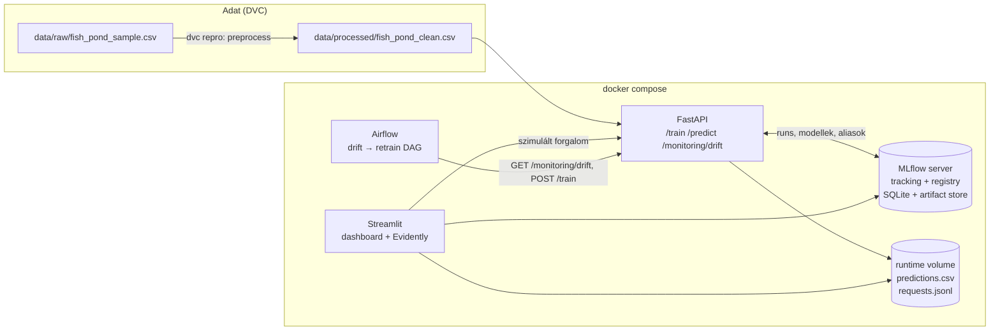

# Fishpond MLOps – halsúly-előrejelzés akvapóniás tavak szenzoradataiból

**Készítette:** Molnár Barnabás (Neptun: B4R87N) – féléves feladat, 2026 ősz

A projekt egy teljes, egyetlen `docker compose up` paranccsal induló MLOps rendszer: adat-előfeldolgozás
(DVC), MLflow-val követett és regisztrált modelltanítás, FastAPI REST API `train` és `predict`
végpontokkal, a kérések és predikciók naplózása, Evidently drift riport egy Streamlit dashboardon,
valamint egy Airflow DAG, ami drift esetén automatikusan újratanít.

| | |
|---|---|
| Adathalmaz | [Sensor Based Aquaponics Fish Pond Datasets](https://www.kaggle.com/datasets/ogbuokiriblessing/sensor-based-aquaponics-fish-pond-datasets) (Udanor, Ogbuokiri, Onyinye, 2022), CC BY 4.0, 5000 soros véletlen minta |
| Célváltozó | `fish_weight_g` – a halak átlagos tömege grammban (regresszió) |
| Bemenetek | időbélyeg, tó azonosító, vízhőmérséklet, zavarosság, oldott oxigén, pH, ammónia, nitrát, állománysűrűség (opcionálisan halhossz) |

---

## Tartalom

1. [Gyors indítás](#gyors-indítás)
2. [Architektúra](#architektúra)
3. [Adat és előfeldolgozás (DVC)](#adat-és-előfeldolgozás-dvc)
4. [Modell és tanító pipeline (MLflow)](#modell-és-tanító-pipeline-mlflow)
5. [A modell jóságának automatikus megőrzése / növelése](#a-modell-jóságának-automatikus-megőrzése--növelése)
6. [REST API](#rest-api)
7. [Naplózás: kérések, predikciók, artifactok](#naplózás-kérések-predikciók-artifactok)
8. [Monitoring: Evidently + Streamlit](#monitoring-evidently--streamlit)
9. [Airflow](#airflow)
10. [Fejlesztés, minőségbiztosítás, CI](#fejlesztés-minőségbiztosítás-ci)
11. [Git munkafolyamat](#git-munkafolyamat)
12. [Screenshotok](#screenshotok)
13. [Projektstruktúra](#projektstruktúra)
14. [Ismert korlátok, vállalt technikai adósság](#ismert-korlátok-vállalt-technikai-adósság)
15. [MI használata](#mi-használata)

---

## Gyors indítás

Előfeltétel: Docker (Docker Desktop) és – az adat letöltéséhez – Python + DVC.

```bash
git clone <repo-url> fishpond-mlops
cd fishpond-mlops
dvc pull                 # adat a DVC remote-ból (lásd lent); a beadott ZIP-ben az adat is benne van
docker compose up --build
```

Az első indításnál az API automatikusan betanítja az első modellt (kb. 1 perc), utána minden szolgáltatás elérhető:

| Szolgáltatás | URL | Leírás |
|---|---|---|
| MLflow UI | http://localhost:5000 | kísérletek, futások, artifactok, model registry |
| REST API (Swagger) | http://localhost:8000/docs | `POST /train`, `POST /predict`, `GET /monitoring/drift`, `GET /health`, `GET /model` |
| Streamlit dashboard | http://localhost:8501 | registry áttekintés, Evidently drift riport, predikciós napló, forgalomszimulátor |
| Airflow | http://localhost:8080 | `fishpond_drift_retraining` DAG (bejelentkezés nélkül, admin joggal) |

Leállítás: `docker compose down` (az adatok a named volume-okban megmaradnak), teljes törlés: `docker compose down -v`.

## Architektúra



Mind a négy szolgáltatás egy compose fájlban van. Az MLflow szerver, az API és a Streamlit ugyanabból
a `fishpond:latest` image-ből fut (más-más paranccsal), az Airflow a hivatalos `apache/airflow` image-et
használja, és a `src/fishpond` csomagot csak olvasható volume-ként kapja meg.

## Adat és előfeldolgozás (DVC)

Az adat nincs a gitben: a nyers és a feldolgozott CSV-t a **DVC** verziózza (`data/raw/fish_pond_sample.csv.dvc`,
`dvc.yaml`, `dvc.lock`). A `preprocess` stage a `python -m fishpond.data` parancsot futtatja:

```bash
dvc repro          # nyers → feldolgozott adat, csak ha a bemenet vagy a kód változott
dvc push / pull    # adat feltöltése / letöltése a remote-ba / remote-ból
```

A DVC remote egy lokális könyvtár (`../fishpond-dvc-storage`), mert ingyenes, mindenki által elérhető
felhő-remote-ot nem akartam regisztrálni; a beadott ZIP tartalmazza a feldolgozott adatfájlt. Ha a
feldolgozott fájl hiányzik, de a nyers megvan, az API indításkor automatikusan előállítja (`ensure_processed`).

**Tisztítási szabályok** (`src/fishpond/data.py`), a fizikailag lehetetlen szenzorértékek `NaN`-ra állnak
(ezeket a modell pipeline-ja imputálja):

| Oszlop | Érvényes tartomány | Tipikus hiba az adatban |
|---|---|---|
| `temperature_c` | 0 – 40 °C | – |
| `turbidity_ntu` | 0 – 1000 NTU | negatív értékek (−56) |
| `dissolved_oxygen` | 0 – 20 mg/L | 40 feletti értékek |
| `ph` | 0 – 14 | negatív és 15 feletti értékek |
| `ammonia` | 0 – 100 | `inf` és 10¹¹ nagyságrendű értékek |
| `nitrate`, `population`, `fish_length_cm` | tág fizikai korlátok | – |

Ezen felül: értelmezhetetlen időbélyegű sorok és nem pozitív célváltozójú sorok törlése, duplikátumok
eltávolítása, időrendezés. Ugyanez a tisztítás a modell része is (`SensorSanitizer` transformer), így a REST
API-n érkező nyers adatok pontosan ugyanazt az előfeldolgozást kapják, mint a tanító adat.

## Modell és tanító pipeline (MLflow)

A modell egy scikit-learn `Pipeline` (`src/fishpond/features.py`, `src/fishpond/model.py`):

1. `SensorSanitizer` – hibás szenzorértékek → `NaN`
2. `DateFeatureExtractor` – időbélyegből: eltelt napok a telepítés óta (a halak korának proxyja), napszak sin/cos
3. `ColumnTransformer` – numerikus: medián imputálás + hiányjelző + standardizálás; `pond_id`: one-hot (ismeretlen tó engedélyezett)
4. `TransformedTargetRegressor` – a jobbra ferde célváltozót `log1p` térben tanulja

Jelölt modellek, mindegyik **GridSearchCV**-vel (3-fold CV) hangolva: `ridge`, `random_forest`,
`hist_gradient_boosting`. A tanítás (`python -m fishpond.training` vagy `POST /train`) MLflow-ban:

* egy szülő run (`training`) a paraméterekkel, az adat ujjlenyomatával (`data_fingerprint`) és a tanító adathalmazzal (`mlflow.log_input`),
* jelöltenként egy beágyazott run a legjobb hiperparaméterekkel, a CV RMSE-vel és a validációs RMSE / MAE / R² értékekkel,
* artifactok: a legjobb modell (`mlflow.sklearn`, signature-rel), `reports/candidate_comparison.csv`,
  `reports/validation_predictions.csv`, `reports/training_config.json`, `reports/predicted_vs_actual.png`,
* a legjobb modell új verzióként a **Model Registry**-be kerül (`fishpond-weight-regressor`), `candidate`, `val_rmse`, `status` tagekkel.

A halhossz erősen összefügg a tömeggel, ezért a tanítás mindkét változatban futtatható
(`include_length` paraméter); alapértelmezésként **nélküle** tanítunk, mert a cél a vízminőségből,
dátumból és tóból becsülni a tömeget.

## A modell jóságának automatikus megőrzése / növelése

A feladat nem a KPI értéke, hanem az, hogy a rendszer automatikusan javítson, illetve ne romoljon. Ezt
három mechanizmus biztosítja:

1. **Automatikus modellválasztás és hiperparaméter-keresés** – minden tanításnál több algoritmus és
   paraméterrács verseng, a legjobb validációs RMSE nyer.
2. **Champion / challenger szabály a Model Registry-ben** (`src/fishpond/registry.py`) – az új modell
   (challenger) csak akkor kapja meg a `champion` aliast – és csak akkor szolgálja ki az API –, ha a
   **jelenlegi championnál jobb ugyanazon, aktuális validációs adaton** (a champion is újra ki van
   értékelve). Opcionálisan minimális relatív javulás is megkövetelhető (`min_relative_improvement`).
   A gyengébb modell is regisztrálásra kerül, de `status=rejected` taggel és indoklással, tehát
   visszakövethető, miért nem élesedett.
3. **Drift-vezérelt újratanítás** – az Airflow DAG naponta lekérdezi az Evidently drift-eredményt, és
   drift esetén újratanít; a champion/challenger szabály itt is véd a romlás ellen.

## REST API

FastAPI, `src/fishpond/api.py`. Interaktív dokumentáció: http://localhost:8000/docs.

| Végpont | Leírás |
|---|---|
| `POST /train` | tanítás + regisztráció + champion/challenger döntés. Body: `{"include_length": false, "candidates": ["random_forest"], "min_relative_improvement": 0.0}` (mind opcionális) |
| `POST /predict` | predikció 1–1000 nyers szenzormérésre, a champion modellel |
| `GET /monitoring/drift` | Evidently drift összefoglaló (tanító adat vs. naplózott kérések) |
| `GET /health`, `GET /model` | állapot, kiszolgált modellverzió |

Példa:

```bash
curl -X POST http://localhost:8000/predict -H "Content-Type: application/json" -d '{
  "records": [{"timestamp": "2021-08-15 12:00:00", "pond_id": "pond_02", "temperature_c": 24.8,
               "turbidity_ntu": 85, "dissolved_oxygen": 6.5, "ph": 7.2, "ammonia": 2.4,
               "nitrate": 540, "population": 50}]}'
# {"request_id": "...", "model_version": "1", "predictions": [61.3]}
```

A végpontok tesztjei (`tests/test_api.py`) valódi MLflow-val (ideiglenes SQLite backend) futtatják végig a
`train → predict → drift → újratanítás` folyamatot, valamint a hibaágakat (nincs modell, nincs adat,
ismeretlen jelölt, validációs hiba, elérhetetlen MLflow). A futó rendszer elleni kézi teszt képernyőképei a
[Screenshotok](#screenshotok) részben vannak.

## Naplózás: kérések, predikciók, artifactok

* **Minden HTTP kérés** → `runtime/requests.jsonl` (módszer, útvonal, státusz, válaszidő) – middleware.
* **Minden predikció** → `runtime/predictions.csv` (időpont, request id, modellverzió, összes bemeneti
  mező, predikció). Ez az Evidently drift riport „current” adathalmaza.
* **MLflow, `predict`:** minden `/predict` hívás egy run a `fishpond-predictions` kísérletben, `request.json`
  és `predictions.csv` artifactokkal, `model_version` és `n_records` paraméterrel, `mean_prediction` metrikával.
* **MLflow, `train`:** lásd fent (modell, riportok, ábra, metrikák, registry verzió).

## Monitoring: Evidently + Streamlit

`src/fishpond/monitoring.py` az Evidently `DataDriftPreset`-et futtatja a tanító adat (reference) és a
naplózott kérések (current) szenzoroszlopain és a tó azonosítón. A Streamlit dashboard
(`streamlit_app/app.py`, vékony réteg a `src/fishpond/dashboard.py` fölött) mutatja:

* a registry összes verzióját (champion / rejected státusz, RMSE, alias),
* a predikciók számát és átlagát modellverziónként,
* a teljes **Evidently HTML riportot** beágyazva,
* a predikciós naplót.

Az oldalsávból szimulált forgalom küldhető az API-nak: normál mintavétel a tanító adatból vagy „hőhullám”
drift (magasabb hőmérséklet, kevesebb oxigén, több nitrát/ammónia). Ugyanez parancssorból:
`python -m fishpond.simulate --n 200 --drift`.

## Airflow

`airflow/dags/fishpond_retraining.py` – `fishpond_drift_retraining` DAG, naponta:

1. `drift_check` (`ShortCircuit`): `GET /health` + `GET /monitoring/drift`; újratanít, ha nincs kiszolgált modell, vagy ha a driftelt oszlopok aránya ≥ 0,5,
2. `retrain_model`: `POST /train` – az új modell csak akkor élesedik, ha jobb.

A DAG vékony réteg, a döntési logika a `src/fishpond/orchestration.py`-ban van (csak standard library, így az
Airflow konténerbe nem kell az ML stack), tesztekkel lefedve. Az Airflow `standalone` módban, SQLite-tal és
jelszó nélküli egyszerű auth managerrel fut – ez fejlesztői/demó beállítás.

## Fejlesztés, minőségbiztosítás, CI

```bash
python -m venv .venv && .venv\Scripts\activate          # Linux/macOS: source .venv/bin/activate
pip install -r requirements-dev.txt && pip install --no-deps -e .
pre-commit install --hook-type pre-commit --hook-type pre-push

pytest --cov                       # tesztek + coverage (min. 95%, a pyproject.toml-ban beállítva)
flake8                             # PEP8, max. sorhossz 120
pyright                            # strict mód a src/ mappára (a feladatban megadott konfiguráció)
dvc repro                          # adat pipeline
python -m fishpond.training        # tanítás lokálisan (MLFLOW_TRACKING_URI kell)
```

| Ellenőrzés | Eredmény |
|---|---|
| pytest | 61 teszt, mind sikeres |
| coverage (`src/` + `tests/`, branch coverage is) | **100%** |
| flake8 (teljes repo) | 0 hiba |
| pyright strict, `src/` | 0 hiba, 0 figyelmeztetés |
| `# pragma: no cover` | 3 db, mindegyik a `if __name__ == "__main__":` CLI-sor indoklással (a `main()` függvények tesztelve vannak) |
| `noqa`, `omit` | nincs |

**Pre-commit hookok** (`.pre-commit-config.yaml`): whitespace/EOF/YAML/TOML/merge-konfliktus/nagy fájl
ellenőrzés, flake8, pyright minden commitnál; pytest + coverage push előtt.

**GitHub Actions** (`.github/workflows/ci.yml`) minden pushra és pull requestre:

1. `quality` – az összes pre-commit hook (flake8, pyright strict, …),
2. `tests` – pytest + coverage (95% alatt elbukik), `coverage.xml` artifact,
3. `docker` – `docker compose config`, image build, smoke test (csak ha az első kettő zöld).

## Git munkafolyamat

* A `main` branch-re csak `--no-ff` merge-dzsel kerül kód (az első „skeleton” commit kivételével), így a
  feature branch-ek története megmarad: `feature/data-preprocessing`, `feature/training-pipeline`,
  `feature/monitoring`, `feature/rest-api`, `feature/airflow-retraining`, `feature/streamlit-dashboard`,
  `feature/ci-quality-gates`, `feature/docker`, `feature/docs`.
* Commit üzenetek: [Conventional Commits](https://www.conventionalcommits.org/) formátum
  (`feat(api): ...`, `fix(...)`, `test(...)`, `ci: ...`, `build: ...`, `docs: ...`).
* GitHubon javasolt a `main` védelme (branch protection: PR kötelező, zöld CI kötelező).

`git log --graph --oneline` mutatja a merge-ök szerkezetét.

## Screenshotok

A futtatásról készült képek a [`docs/screenshots`](docs/screenshots) mappában:

| Fájl | Tartalom |
|---|---|
| `01_docker_compose_ps.png` | `docker compose ps` / `docker stats` – mind a 4 konténer fut, az MLflow, API és Streamlit `healthy` |
| `03_mlflow_experiments.png` | MLflow – a `fishpond-training` kísérlet tanító runjai (adathalmazzal, regisztrált modellel) |
| `04_mlflow_run_overview.png` | MLflow – egy tanító run: jelölt (child) run, tagek (`promoted`, indoklás), metrikák, regisztrált verzió |
| `04b_mlflow_run_artifacts.png` | MLflow – a run artifactjai (`reports/…`, predikált vs. valós ábra) |
| `05_mlflow_model_registry.png` | MLflow Model Registry – v1 `superseded`, v2 `champion` alias, v3–v4 (Airflow újratanítás) `rejected` |
| `06_mlflow_predictions.png` | MLflow – a `/predict` hívások runjai a `fishpond-predictions` kísérletben |
| `07_swagger_train.png` | Swagger – `POST /train` hívás és válasz (előléptetés indoklással) |
| `08_swagger_predict.png` | Swagger – `POST /predict` hívás és válasz |
| `09_api_test_python.png` | Python teszt a futó API ellen (`scripts/api_smoke_test.py`) |
| `10_streamlit_registry.png` | Streamlit dashboard – registry áttekintés, predikciók verziónként |
| `11_streamlit_evidently.png` | Streamlit dashboard – beágyazott Evidently drift riport (szimulált „hőhullám” drift) |
| `12_airflow_dag.png` | Airflow – a `fishpond_drift_retraining` DAG sikeres futásai |
| `13_pytest_coverage.png` | 61 teszt, 100% coverage, flake8 0 hiba, pyright strict 0 hiba |

A böngészős képek Playwright-tal készültek a futó rendszerről; a terminálos képek (01, 09, 13) a valódi
parancskimenetek renderelt képei.

## Projektstruktúra

```
├── src/fishpond/            üzleti logika (minden itt van, 100% lefedettség)
│   ├── config.py            környezeti változókból olvasott beállítások
│   ├── data.py              betöltés, tisztítás, DVC preprocess CLI
│   ├── features.py          sklearn transformerek (szenzor-tisztítás, dátum-jellemzők)
│   ├── model.py             jelöltek, grid search, metrikák
│   ├── training.py          MLflow tracking + registry + champion/challenger
│   ├── registry.py          promóciós szabály, registry műveletek
│   ├── service.py           champion modell betöltése, predikciók MLflow-ba
│   ├── api.py               FastAPI alkalmazás
│   ├── prediction_log.py    kérés- és predikciónapló
│   ├── monitoring.py        Evidently drift riport
│   ├── dashboard.py         a Streamlit dashboard logikája
│   ├── simulate.py          forgalomszimulátor (drifttel)
│   └── orchestration.py     Airflow-hoz: drift → újratanítás döntés, API kliens
├── tests/                   pytest tesztek (szintetikus adat, ideiglenes MLflow)
├── streamlit_app/app.py     Streamlit nézet (vékony réteg)
├── airflow/dags/            Airflow DAG (vékony réteg)
├── scripts/                 kézi API teszt a futó rendszer ellen
├── data/                    DVC által verziózott adat (*.dvc, dvc.yaml, dvc.lock)
├── docs/screenshots/        képernyőképek
├── Dockerfile, docker-compose.yml
├── .pre-commit-config.yaml, .github/workflows/ci.yml
├── requirements.txt, requirements-dev.txt (pontos verziók)
└── pyproject.toml           pyright, pytest, coverage konfiguráció
```

## Ismert korlátok, vállalt technikai adósság

* **Nagyon magas R²** (random forest ≈ 0,999): a validáció véletlen sorfelosztással készül, és ugyanannak a
  tónak az egymáshoz közeli időpontú mérései nagyon hasonló célértékkel bírnak, így ez optimista becslés.
  Valós becsléshez tavak szerinti vagy időbeli felosztás kellene; mivel a KPI nem része a feladatnak, ezt
  dokumentált egyszerűsítésként hagytam.
* **Modell szerializáció:** a modell `cloudpickle` formátumban kerül az MLflow-ba (a saját transformerek miatt;
  az MLflow erre figyelmeztet). Csak megbízható, saját registry-ből töltünk be modellt.
* **DVC remote** lokális könyvtár – megosztott felhő-remote (pl. S3, DagsHub) lenne az éles megoldás.
* **Pandas verzió:** az Evidently 0.7.23 nem kompatibilis a pandas 3-mal, ezért pandas 2.3.3 van rögzítve.
* **Airflow** `standalone` módban és auth nélkül fut (demó célra); éles környezetben külön scheduler,
  Postgres metaadatbázis és bejelentkezés kellene. A DAG fájlt nem fedi a coverage (az `src/`-n kívül van),
  de csak a tesztelt `fishpond.orchestration` függvényeit hívja.
* **Szinkron tanítás:** a `POST /train` megvárja a tanítás végét (~1 perc); nagyobb adatnál háttérfeladat kellene.
* Docker Desktop indításakor két beragadt Unix socket fájl (`dockerInference`, `engine.sock`) miatt a Docker
  nem indult el; ezeket a mappákat félre kellett tenni (gépspecifikus hiba, nem a projekté).

## MI használata

A projektet **Claude Code** (Anthropic, Claude Opus 5.5) segítségével készítettem. Mire használtam:

* a projektstruktúra és az architektúra megtervezése a követelménylista alapján,
* kódgenerálás (adattisztítás, sklearn pipeline, MLflow/registry logika, FastAPI, Evidently, Streamlit,
  Airflow DAG, Dockerfile, compose, CI), majd a tesztek megírása,
* hibakeresés: pyright strict hibák javítása, Evidently–pandas 3 inkompatibilitás, MLflow 3 API változások
  (pl. modellverzió típusa), Docker Desktop indulási hibája,
* dokumentáció (ez a README) és a képernyőképek elkészítése.

Hogyan: az MI kis lépésekben dolgozott, minden lépés után futtatva a teszteket, a flake8-at és a pyright-ot;
az eredményeket és a commitokat átnéztem. A commitokban a `Co-Authored-By` sor jelzi az MI közreműködését.

## Adatforrás és licenc

Udanor, C., Ogbuokiri, B., Onyinye, I. (2022): *Sensor Based Aquaponics Fish Pond Datasets*, Kaggle,
CC BY 4.0. A projektben az eredeti 11 fájlból összefűzött, 5000 soros véletlen minta szerepel.
